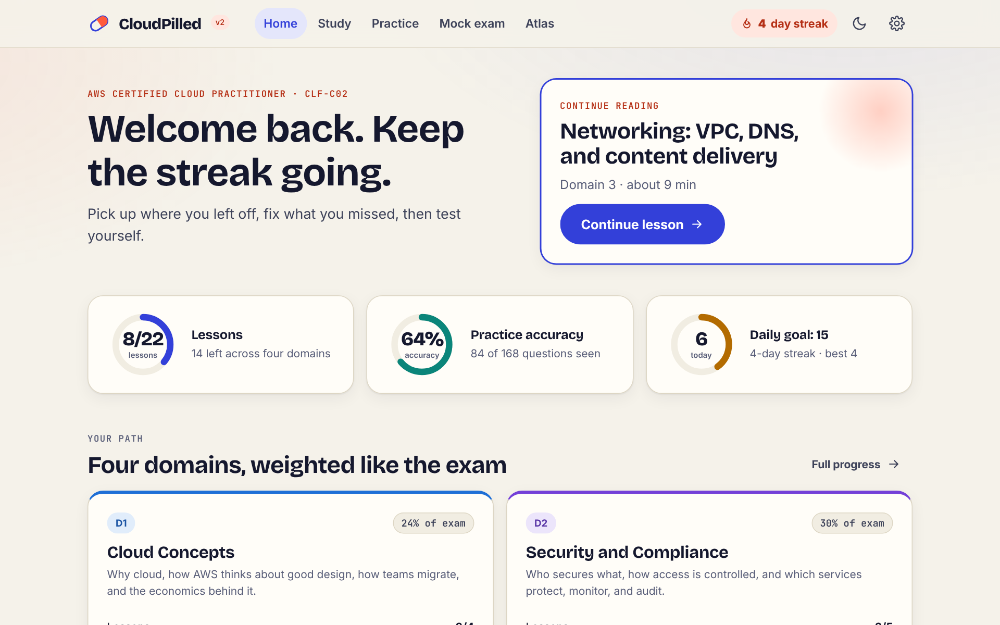
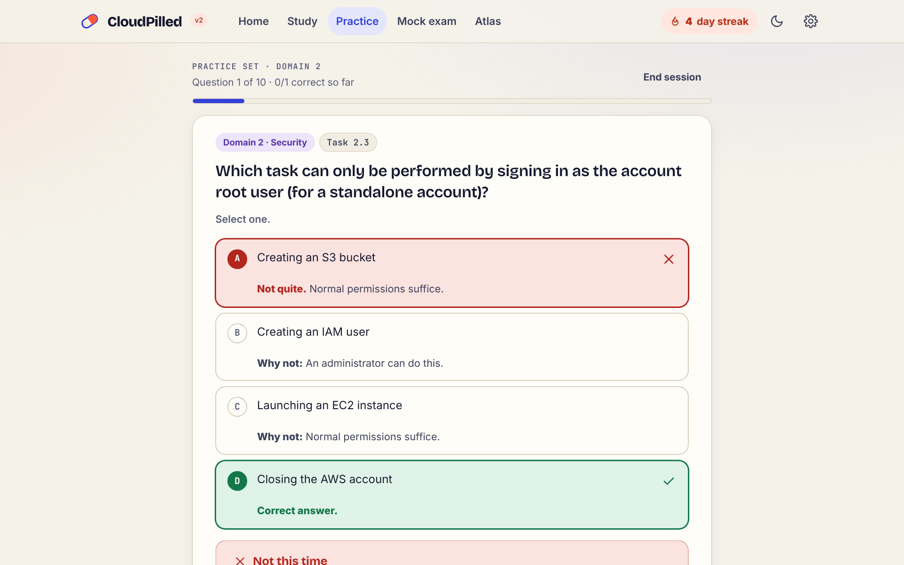
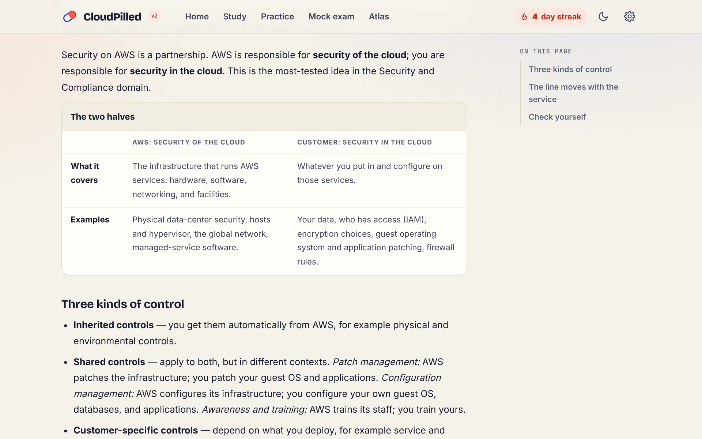
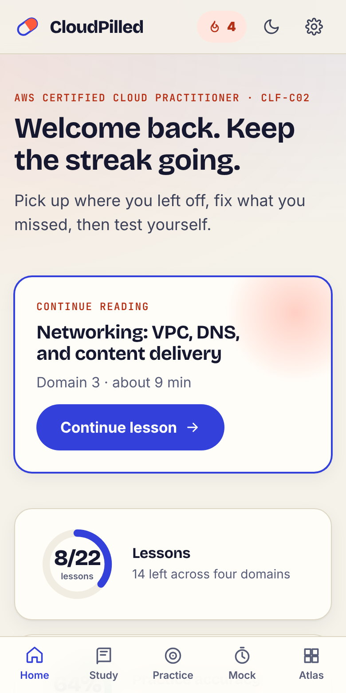
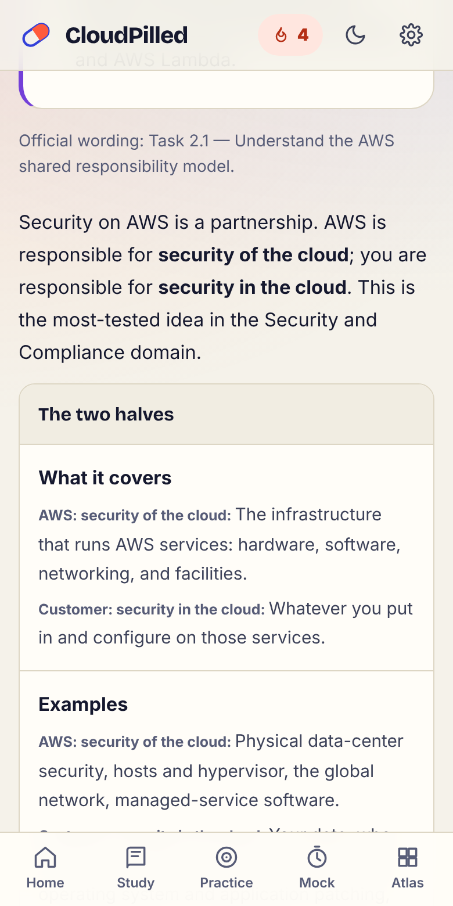
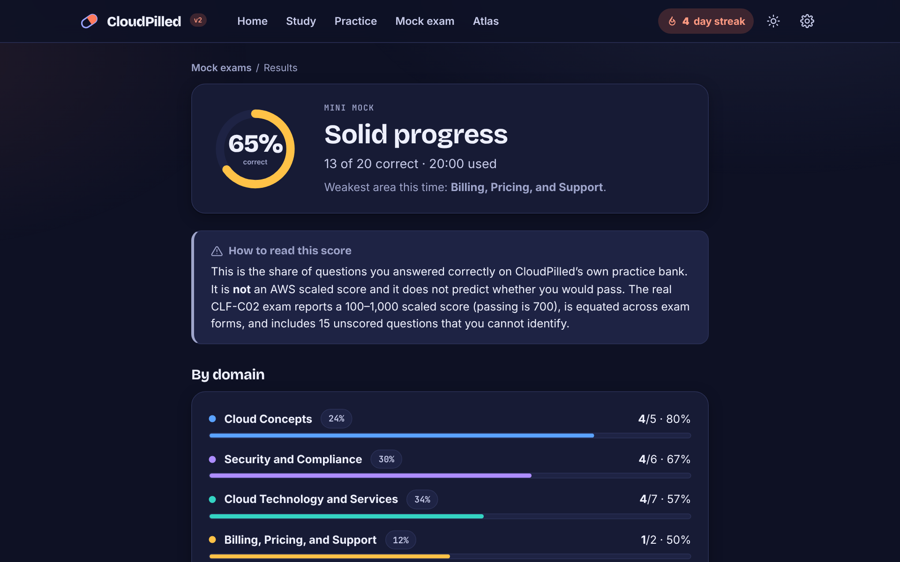

<div align="center">


# CloudPilled v2

**Learn the cloud. Pass the exam. One concept at a time.**

An exam-aligned study app for the **AWS Certified Cloud Practitioner (CLF-C02)**. Short lessons for first-time learners, original practice questions with the reasoning behind every option, timed mock exams, and progress that stays on your device.


[Features](#features) &nbsp;·&nbsp; [Exam alignment](#exam-alignment) &nbsp;·&nbsp; [Run it](#run-it-locally) &nbsp;·&nbsp; [Deploy](#deploy-to-vercel) &nbsp;·&nbsp; [Maintain the content](#maintaining-the-content)

</div>

<p align="center">
  
</p>

<p align="center">
  
  &nbsp;
  
</p>

<p align="center">
  
  &nbsp;
  
  &nbsp;
  
</p>

<p align="center"><sub>Screenshots use sample progress data. The progress shown is not a real learner's.</sub></p>

---

## About

CloudPilled began as a service-reference app with a quiz. v2 rebuilds it around how people actually prepare for a certification: **learn a concept, practice it, review the mistake, and come back tomorrow.**

It is written for someone who has never studied for the Cloud Practitioner exam. Every lesson maps to an official task statement, explains acronyms on first use, and calls out the pairs of services learners confuse most (SQS vs. SNS, GuardDuty vs. Inspector, CloudFront vs. Global Accelerator, and so on). Every practice question tells you the clue to look for and why each wrong answer is wrong.

There is no account, no server, no database, and no API key. Everything runs in the browser and saves to local storage.

## Features

- **A dashboard that tells you what to do next.** One primary card resumes an unfinished mock, practice set, or lesson, or suggests the next lesson, your review queue, or your weakest domain.
- **22 lessons in four domain paths.** Concise explanations, comparison tables, worked examples, “easy to confuse” call-outs, three quick checks per lesson, and links to official AWS documentation.
- **Practice with immediate feedback.** Pick a scope (all domains, one domain, or one task statement), a mode (mixed, weak spots first, or missed only), and a length. Each answer shows the key clue, a rationale, and an explanation for every option.
- **Single- and multiple-response questions.** Multiple-response items say how many to select and are scored all-or-nothing.
- **A review queue.** Anything you last answered wrongly waits there until you answer it correctly.
- **Mock exams.** A **full-length mock** (65 questions, 90 minutes) and a **mini mock** (20 questions, 28 minutes), both drawn in the published domain proportions. They include a countdown that survives refreshes, a question navigator, flagging, and a submit confirmation.
- **An honest scoring model.** Mock results are the percentage you got right on this question bank, with a domain breakdown. They are explicitly **not** an AWS scaled score and make no claim about passing. See [What the scores mean](#what-the-scores-mean).
- **A service atlas with flashcards.** 135 searchable one-sentence summaries of the services in the exam guide, with spaced-repetition flashcards.
- **Progress you can trust.** Per-task readiness, a 28-day activity map, a daily goal and streak, session history, and JSON export/import.
- **Built for long sessions.** Light and dark themes, a calm reading layout, keyboard shortcuts (`1`–`5` select, `Enter` check or next, `N`/`P`/`F` in mocks), visible focus, reduced-motion support, and a bottom tab bar on phones.

## Study workflow

```text
Dashboard ─▶ Lesson ─▶ Quick checks ─▶ Practice this topic ─▶ Results ─▶ Review queue
    ▲                                                                         │
    └──────────────  Mini mock ─▶ Full mock ◀── weakest domain ◀──────────────┘
```

1. Start at **Home**. The first card says where to begin.
2. Read a **lesson**, answer its quick checks, and mark it complete.
3. Run a **practice set** for that task statement. Read every explanation, including the ones for options you did not pick.
4. Work through the **review queue** until it is empty.
5. Take a **mini mock** as a checkpoint, then a **full mock** when your domain readiness is mostly “Solid”.

## Exam alignment

Verified against AWS's official pages on **2026-11-24**:

| | |
| --- | --- |
| Exam | AWS Certified Cloud Practitioner, code **CLF-C02** (exam guide version 1.0) |
| Format | 65 questions (50 scored, 15 unscored), multiple choice and multiple response, 90 minutes |
| Scoring | Scaled 100–1,000; 700 to pass; compensatory (no per-domain minimum) |
| Sources | [Exam guide (PDF)](https://d1.awsstatic.com/training-and-certification/docs-cloud-practitioner/AWS-Certified-Cloud-Practitioner_Exam-Guide.pdf) · [Certification page](https://aws.amazon.com/certification/certified-cloud-practitioner/) |

### Content by domain

| Domain | Exam weight | Lessons | Practice questions (multiple response) | Quick checks |
| --- | ---: | ---: | ---: | ---: |
| 1. Cloud Concepts | 24% | 4 | 36 (7) | 12 |
| 2. Security and Compliance | 30% | 5 | 49 (6) | 15 |
| 3. Cloud Technology and Services | 34% | 9 | 57 (3) | 27 |
| 4. Billing, Pricing, and Support | 12% | 4 | 26 (3) | 12 |
| **Total** | 100% | **22** | **168 (19)** | **66** |

All 19 official task statements (1.1–4.3) have at least one lesson and at least six practice questions. A 65-question mock draws 16 / 19 / 22 / 8 questions from domains 1–4, which is the largest-remainder split of the published weights.

### Where AWS has moved since the exam guide

The guide is version 1.0 and has not changed, but parts of AWS have. CloudPilled teaches the concept and flags the difference rather than pretending nothing changed:

- **Support plans.** AWS's current pages list **Basic, Business Support+, Enterprise Support, and Unified Operations** and announce that **Developer, Business, and Enterprise On-Ramp end on 1 January 2027**. The exam guide still uses the older names. Lessons and questions teach the tiers (what each level adds) and note both naming generations.
- **AWS IQ** is listed in the guide; AWS reports it was **discontinued on 28 May 2026**.
- **AWS Snowball** (part of the Snow Family) is listed in the guide; AWS announces **end of support in commercial Regions on 31 December 2026**.
- **AWS Cloud9** is listed in the guide; AWS documents it as **no longer available to new customers**.

Re-check these before you book your exam; an exam update may follow.

### What the scores mean

Mock and practice scores are the share of questions you answered correctly **on CloudPilled's own question bank**. They are not scaled scores, are not equated across forms, and do not predict whether you would pass. Multiple-response questions are all-or-nothing and unanswered questions count as incorrect. The questions are **original**, written to the published objectives. They are not real exam questions, and nothing here claims an item appeared on the exam.

## Tech stack

| | |
| --- | --- |
| UI | React 19, React Router 7, TypeScript (strict) |
| Build | Vite 8 |
| Styling | Hand-written CSS with design tokens, light/dark themes, self-hosted fonts (Bricolage Grotesque, Inter, JetBrains Mono) |
| State | A small external store over `localStorage` (versioned and sanitized), read with `useSyncExternalStore` |
| Tests | Vitest (content validation, scoring, session building, persistence, migration) |
| Quality | ESLint with typescript-eslint and the React hooks rules |

### Why this stack

v1 was a single 130 KB script of global functions with an optional Node proxy for an AI chat feature. v2 keeps the idea (static, no database, local progress) and changes the pieces that were holding it back: typed content with automated validation, real routing, testable logic, and a build step that Vercel understands without configuration.

**Study Buddy (the v1 AI chat) was retired.** It required an NVIDIA API key and a server, could not run as a static Vercel site, would have exposed the key's quota to anyone on a public deployment, and generated answers that could not be checked against the exam guide. It is still in git history (for example `git show 2f838b8:server.js`) if you want it back as an optional feature.

## Run it locally

You need Node.js 20.19 or newer (22 recommended).

```bash
npm install
npm run dev
```

Open <http://127.0.0.1:5173>. No `.env` file or API key is needed.

| Command | What it does |
| --- | --- |
| `npm run dev` | Start the Vite dev server |
| `npm run build` | Type-check, then build to `dist/` |
| `npm run preview` | Serve the production build locally |
| `npm run lint` | ESLint |
| `npm run typecheck` | `tsc` with no emit |
| `npm test` | Vitest: content validation and logic tests |
| `npm run validate:content` | Just the content validation suite |
| `npm run check:links` | Confirm every official AWS reference still resolves (needs network) |
| `npm run check` | Lint, type-check, test, and build in sequence (what CI runs) |

## Deploy to Vercel

CloudPilled is a static single-page app with no server code and **no environment variables**.

[](https://vercel.com/new/clone?repository-url=https%3A%2F%2Fgithub.com%2Fztxv%2FCloudPilled-v1&project-name=cloudpilled&repository-name=cloudpilled)

Import the repository in Vercel. It detects Vite automatically:

| Setting | Value |
| --- | --- |
| Framework preset | Vite |
| Build command | `npm run build` |
| Output directory | `dist` |
| Install command | `npm install` |
| Environment variables | None |
| Node.js version | 20.19 or newer (the default is fine) |

[`vercel.json`](vercel.json) contains one rewrite that serves `index.html` for any path that is not a file, so deep links such as `/lesson/compute` work after a refresh. Static files are served first, so assets are unaffected.

## Maintaining the content

All curriculum content is plain TypeScript, validated on every test run.

```text
src/
  content/
    domains.ts          Exam code, domains, weights, and the 19 official task statements
    refs.ts             Registry of official AWS links, referenced by key
    atlas.ts            Service atlas entries
    builders.ts         S() and M() helpers for writing questions compactly
    lessons/            One file per domain; each lesson maps to task statements
    questions/          One file per domain
    content.test.ts     Validation suite
  lib/                  Store, scoring, session builders, progress, legacy import (all unit-tested)
  components/  pages/   UI
  styles/               Tokens, base, components, pages
```

A question is one line of authoring:

```ts
S('d3-016', '3.3', 'A company wants to run a short piece of code whenever a file is uploaded, without managing servers…',
  'AWS Lambda',                                         // the correct option
  ['Amazon EC2 :: You would manage servers and pay while they run.',   // distractors: "option :: why it is wrong"
   'Amazon EKS :: Container orchestration.',
   'AWS Direct Connect :: Network connectivity.'],
  'whenever a file is uploaded, without managing servers',   // the clue, quoted from the stem
  'Lambda runs event-driven code with no servers to manage.', // rationale
  ['lambda'])                                            // reference keys from refs.ts
```

`npm test` fails if a question has no answer key, the wrong number of options, a distractor without an explanation, a domain tag that disagrees with its task statement, a reference that is not in the registry, a clue that is not quoted from the stem, or a near-duplicate stem. Question ids are permanent: progress is keyed on them, so retire a question rather than reusing its id.

## Your data

Progress lives in `localStorage` under `cloudpilled:v2` and never leaves your browser. Use **Settings → Export progress** for a backup, and **Import** to restore it on another device.

Saved data is versioned and sanitized on load, so malformed or older data degrades gracefully instead of crashing the app. If you used CloudPilled v1 in the same browser, v2 imports your theme, daily activity, daily goal, “known” services, and flashcard schedule on first load and leaves the old keys untouched. v1 quiz statistics were keyed on question text and a different category scheme, so they cannot be mapped to exam domains and are not imported.

## Disclaimer

CloudPilled is an unofficial study aid. It is not affiliated with, endorsed by, or sponsored by Amazon Web Services. AWS, the AWS Certified Cloud Practitioner name, and related marks belong to Amazon.com, Inc. or its affiliates. Content was checked against official AWS documentation on the date above, but AWS changes quickly: confirm exam details and service behavior with the linked official sources.
